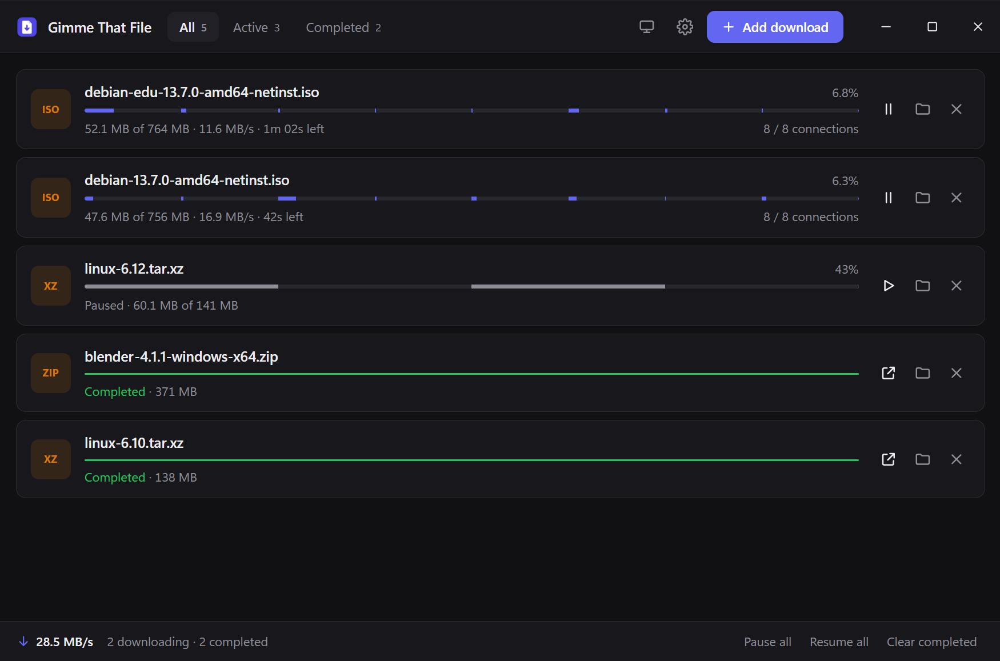

<div align="center">


# Gimme That File

**A fast, clean download manager written in Rust.**
Paste a link, pick a folder, done.

[](https://github.com/ItsBlqz/gimmethatfile/actions/workflows/ci.yml)
[](https://github.com/ItsBlqz/gimmethatfile/releases/latest)
[](#license)

<picture>
  <source media="(prefers-color-scheme: light)" srcset="docs/screenshot-light.png" />
  
</picture>

</div>

## Download

**Windows 10/11 (64-bit):** get the latest version from the
[**Releases page**](https://github.com/ItsBlqz/gimmethatfile/releases/latest).

| File | What it is |
|---|---|
| `GimmeThatFile-x.y.z-x64-setup.exe` | Installer (recommended). Adds a Start menu entry and an uninstaller. |
| `GimmeThatFile-x.y.z-x64-portable.exe` | Single file, no install. |
| `SHA256SUMS.txt` | Checksums to verify your download. |

> The app isn't code-signed yet, so Windows SmartScreen may show a warning.
> Click **More info → Run anyway**. The checksums let you confirm the file is
> the one built by our [release workflow](.github/workflows/release.yml).

macOS and Linux builds aren't published yet. The engine is cross-platform and
tested on Linux; you can [build from source](#building-from-source).

## Features

- **Multi-connection downloads**: splits a file into segments and downloads them
  in parallel. Against servers that cap each connection, that's up to
  [10x faster](docs/BENCHMARKS.md).
- **Dynamic segmentation**: a connection that finishes early takes half of the
  largest remaining segment, so every connection works until the end.
- **Adapts to the server and your line**: ramps connections up gradually,
  keeps only the ones that actually add speed, backs off when the server says
  "too many requests", and tries again later.
- **Speed limits**: for all downloads together and per download, changeable
  while downloading.
- **Pause and resume**, even after closing the app or a crash. If the file
  changes on the server, the app notices and restarts it.
- **Queue**: choose how many downloads run at once.
- **Lives in the tray**: closing the window keeps downloads running. Quit from
  the tray icon.
- **Safe by default**: downloads go to `name.ext.gtfpart` and are renamed only
  when complete. Existing files are never overwritten, and file names from
  servers are sanitized.
- **Small and quick**: about a 2 MB installer, using the system WebView instead
  of a bundled browser.
- Paste links anywhere (`Ctrl+V`), drag links onto the window, `Ctrl+N` to add.
  Light, dark, or follow your system.

## How it works

Most servers limit how fast a *single* connection can go, and one TCP
connection over a long distance can't fill a fast line. HTTP lets a client ask
for one part of a file:

```http
GET /file.iso
Range: bytes=52428800-
```

The server answers `206 Partial Content` with just that part. So Gimme That
File:

1. **Probes** with `Range: bytes=0-0` to learn the size and whether ranges
   work. If they don't, it falls back to one connection.
2. **Splits** the file and opens several connections, each writing into its
   own region of the file.
3. **Steals work**: a connection that finishes early takes half of the biggest
   remaining region. If the region right after it is idle, it simply keeps
   reading on the same connection.
4. **Adapts** the number of connections: it measures whether more
   connections add speed and backs off when they don't or when the server
   pushes back.
5. **Saves** which bytes are still missing, so resuming continues exactly where
   it stopped.

The full design, including the invariants that keep downloads correct, is in
[docs/ARCHITECTURE.md](docs/ARCHITECTURE.md).

## Benchmarks

Against a local server that caps each connection at 2 MB/s (a reproducible
setup: `cargo run --release -p gtf-engine --example bench`):

| Connections | 1 | 2 | 4 | 8 | 16 |
|---|---:|---:|---:|---:|---:|
| Speed-up | 1.0x | 2.0x | 3.8x | 6.7x | 9.9x |

Real-world results depend on the server and your line. When a single
connection already fills your line, extra connections don't help; the engine
notices and falls back to fewer. See
[docs/BENCHMARKS.md](docs/BENCHMARKS.md) for measurements and caveats.

## Building from source

Requirements: [Rust](https://rustup.rs) 1.95+. On Windows, the Visual Studio
Build Tools (C++ workload); WebView2 ships with Windows 10/11. On Linux, the
[Tauri prerequisites](https://v2.tauri.app/start/prerequisites/#linux).

```sh
git clone https://github.com/ItsBlqz/gimmethatfile
cd gimmethatfile
cargo run -p gimmethatfile              # run the app
cargo test --workspace                    # run the tests

# Build the installer (output: target/release/bundle/nsis/)
cargo install tauri-cli --version "^2" --locked
cd app && cargo tauri build
```

The download list and settings are stored in
`%APPDATA%\com.itsblqz.gimmethatfile\downloads.json`. Set
`GIMMETHATFILE_DATA_DIR` to use a different folder.

## Project layout

```
crates/engine/      Download engine (no UI, fully tested)
  src/probe.rs        Range support, size and file-name detection
  src/job.rs          Segmented download, work stealing, the supervisor
  src/control.rs      How many connections to use (measured hill climb)
  src/limit.rs        Speed limits (shared token bucket)
  src/manager.rs      Queue, pause/resume, persistence, speed meter
  tests/e2e.rs        End-to-end tests against an in-process HTTP server
  examples/           get (CLI download), bench (reproducible benchmark)
app/                Tauri v2 desktop shell
ui/                 Plain HTML/CSS/JS front end (no build step)
docs/               Architecture and benchmarks
```

## Roadmap

Next up: browser download capture, notifications and auto-update. The full list is in [TODO.md](TODO.md).
Ideas and votes are welcome in [issues](https://github.com/ItsBlqz/gimmethatfile/issues).

## Contributing

Contributions are welcome! Read [CONTRIBUTING.md](CONTRIBUTING.md) for setup,
testing and the pull-request process. Please follow our
[Code of Conduct](CODE_OF_CONDUCT.md), and report security issues privately as
described in [SECURITY.md](SECURITY.md).

## License

Licensed under either of

- Apache License, Version 2.0 ([LICENSE-APACHE](LICENSE-APACHE))
- MIT license ([LICENSE-MIT](LICENSE-MIT))

at your option. Unless you explicitly state otherwise, any contribution you
intentionally submit for inclusion in this project is dual licensed as above,
without any additional terms or conditions.

Gimme That File is a general-purpose tool. You are responsible for having the
right to download the files you download with it.
